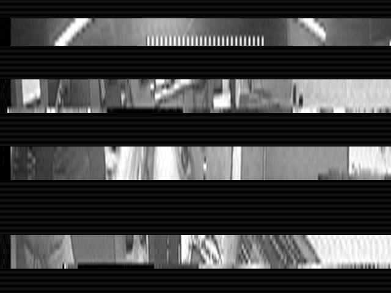

# FPGA FPV receiver

Analog 5.8 GHz FPV video receiver. A HackRF One is the RF front end, a Gowin
GW2A-18 (Tang Primer 20K) runs the whole digital pipeline, and the output goes
straight to a monitor over HDMI. There's no PC and no bridge MCU in the signal
path: the FPGA talks to the HackRF itself, as a USB 2.0 Hi-Speed host.

```
 5.8 GHz                    USB 2.0 Hi-Speed bulk            HDMI
 antenna ──▶ HackRF One ──────────────────────────▶ Tang Primer 20K ──▶ monitor
             (MAX2837 +                             GW2A-LV18PG256
              8-bit IQ)                             + USB3317 ULPI PHY
```

The whole reason I started this was to get the FPGA to host the USB bus on its
own. Normally you talk to a HackRF with libusb on a PC, or at least a soft CPU
core running a USB stack. Here there's neither. The ULPI link and the USB host
are hand-written Verilog driving a Microchip USB3317 PHY wired to FPGA pins.

It's roughly 7,500 lines of my own RTL and about 1,200 lines of Icarus
testbenches, on a GW2A-LV18PG256C8/I7. Timing closes (worst setup +5.42 ns,
worst hold +0.21 ns, nothing violated). BSRAM is the tight resource at 44 of 46;
logic sits at 37%, registers 24%, 2 DSPs.

## The USB host

This is the part that was actually hard, so it's the part most of the code is.
Against the USB3317 PHY the FPGA does:

- ULPI link layer: register reads and writes, TX CMD framing, and the bus
  turnaround that trips you up if you get the timing wrong.
- Host FSM: SOF on the 125 µs microframe timer, SETUP/IN/OUT transactions,
  DATA0/DATA1 toggling, CRC5 on tokens and CRC16 on data, handshake decoding.
- Enumeration: address assignment, descriptor fetch, then a scripted control
  sequence that brings the HackRF up (Si5351C clocks, sample rate, baseband
  filter, VGA/LNA gain, RX mode).
- Bulk IN: back-to-back packet bursts, a depacketizer, and an async FIFO from
  the 60 MHz ULPI clock into the 27 MHz processing clock.

The two bugs that ate the most time are both written up in the
[engineering log](docs/engineering-log.md). One is the ULPI bus-turnaround rule
that silently wedges the PHY. The other is a vendor request number I'd assumed
was a register read, which is actually `SPIFLASH_ERASE` and wiped the HackRF's
firmware once. There's an interlock now so that can't happen again.

## Signal chain

```
   ULPI 60 MHz  │  processing 27 MHz                        │ pixel 48.6 MHz
                │                                           │
  usb host FSM ─┼─▶ depacketizer ─▶ async FIFO ─▶ fm_demod ──┼─▶ video_line_fifo
                │                                 │         │        │
                │                      ┌──────────┴──┐      │        ▼
                │                      ▼             ▼      │   fpv_video_out
                │                 rf_rssi      ntsc_sync_dpll    (525→1024 DDA,
                │                      │             │      │     240→600 vert,
                │              ┌───────┴──────┐      │      │     genlock)
                │              ▼              ▼      │      │        │
                │        AGC loop      fpv_auto_scanner     │        ▼
                │     (vendor rq 20)   (40 ch × RSSI)       │   DVI / TMDS ─▶ HDMI
```

- `fm_demod`: conjugate product of adjacent samples into a 10-stage vectoring
  CORDIC `atan2` (π = 32768), then de-emphasis and an RSSI estimate. I checked
  the CORDIC bit-for-bit against a reference `atan2` (correlation 1.0000), so
  it's not the thing to suspect when the picture is wrong.
- `ntsc_sync_dpll`: sync slicer placed from the measured signal levels, a
  line-locked NCO that learns the period, vertical lock by integrating sync.
  Parameterised by sample rate.
- `fpv_video_out`: 1024×600@60 raster (1312 × 617 total) off a 243 MHz serial /
  48.6 MHz pixel clock, DDA-upscaling 525→1024 across and 240→600 down. The
  output line rate is 37.02 kHz against the source's 15.734 kHz, so a 16-line
  elastic FIFO plus genlock on the source vsync does the job of a frame buffer.
  That matters because one field at 8 bpp is about 1 Mbit and the device only
  has 828 kbit of BSRAM.
- `fpv_auto_scanner`: sweeps all 40 channels of the 5.8 GHz FPV bands, scores
  each by RSSI and sync lock, and parks on the best one.
- AGC: a closed loop from `rf_rssi` back out through a USB vendor request to the
  HackRF's VGA. The carrier moves about 19 dB between a far and a near camera, so
  a fixed gain either clips up close or sinks into noise far off.

## What's measured

Everything here came off the board or out of a capture; how I measured it is in
the log.

| | |
|---|---|
| Bulk IQ throughput | 16 MB/s at 8 Msps, FIFO overflow count 0 |
| Channel scan | all 40 channels RSSI ~150 with the camera off; channel 27 / 5800 MHz rose to ~12000 with it on, and the scanner parked there |
| FM demod | sync tip −2.30 MHz, active video +0.73 MHz mean, 3.03 MHz apart; sample noise 0.19 MHz against a 0.85 MHz video swing |
| Line lock | period 1269–1272 samples against NTSC's 1271; 15 of 15 lines exactly 525 px; 0.0 px/line horizontal drift |
| HDMI | raster, PLL and TMDS output confirmed live on a monitor |



That's real picture content, decoded offline from a raw IQ capture, which is how
I know the RF, the USB transport and the demodulator are all fine. The black
bands are the open bug described below.

## Status

Working: board bring-up, the FPGA-side USB host and enumeration, bulk IQ
streaming, the 40-channel scanner, FM demod, line and field sync lock, and HDMI
output. The AGC loop is built but I haven't confirmed it against a live carrier
yet.

Still broken: the picture on the monitor is mush, and for a reason I've measured
rather than guessed. The IQ stream comes in as islands, not a continuous stream.
Inside any 8192-sample block the line period and autocorrelation are clean, but
at every multiple of 8192 samples there's a phase discontinuity, aligned to that
grid with vector strength 1.000. 8192 samples is 16384 bytes, exactly half the
HackRF's USB bulk buffer, so whole buffer halves are being dropped. The host FSM
sits idle about 40% of each cycle waiting to issue a SOF while the radio keeps
producing. So this is a transport duty-cycle problem, not a video one: no sync
separator can put back time that was never delivered. Section 7 of the log has
the plan.

## Repo layout

```
fpga_ulpi_test/      main design: USB host, demod, sync, video, HDMI
  src/               RTL
  sim/               Icarus testbenches (ULPI device model, FIFO, pipeline, DPLL)
  src/dvi/           vendor DVI IP, not redistributed (see src/dvi/README.md)
fpga_hello/          bring-up: UART "hello", first bitstream
fpga_uart_probe/     bring-up: pin probe over UART
fpga_bustest/        bring-up: ULPI bus walk
tools/               grab.py (UART capture), render.py, ntsc_gen.py, bl702/
captures/            decoded frames and the offline Python decoder
docs/                engineering log
```

## Build

You need Gowin EDA (the free licence covers the GW2A-18) and `openFPGALoader`.

```bash
# regenerate the vendor DVI IP first (see fpga_ulpi_test/src/dvi/README.md)
cd fpga_ulpi_test
gw_sh build.tcl                                       # synthesise + place & route
openFPGALoader -b tangprimer20k impl/pnr/enum.fs      # program
python3 ../tools/grab.py 14                           # capture telemetry + IQ
```

Telemetry comes out of `/dev/ttyUSB1` at 115200:

```
V=1D50 AD=1 ST=09FA SI=0E N=467C     HackRF enumerated, Si5351 set, bulk flowing
IQ: WR=5640 RD=5640 OCC=0000 OV=0    IQ FIFO healthy, no loss
FPV: CH=1B F=16A8 RS=0076 LK=0       parked on 5800 MHz
```

Simulation needs no hardware:

```bash
iverilog -o tb -s tb_fpv_pipeline fpga_ulpi_test/sim/tb_fpv_pipeline.v \
         fpga_ulpi_test/src/*.v tools/gowin_stubs.v && ./tb
```

If the board looks dead, check `lsusb | grep 0403:6010` first. The Dock's USB
bridge is a BL702 emulating an FT2232D, and if its firmware is lost the board
looks exactly like dead silicon when it isn't. `tools/bl702/README.md` has the
rebuild procedure, including three images that don't work and why.

## Hardware

- FPGA: Sipeed Tang Primer 20K + Primer 20K Dock, Gowin GW2A-LV18PG256C8/I7
- USB PHY: Microchip USB3317 (ULPI, on FPGA pins)
- Radio: HackRF One
- Source: a 5.8 GHz analog FPV camera/VTX, NTSC
- Clocks: 27 MHz reference, 60 MHz ULPI, 243 MHz serial (rPLL ×9) and 48.6 MHz
  pixel (CLKDIV ÷5)

## Vendor IP (DVI)

`fpga_ulpi_test/src/dvi/DVI_TX_Top.v` is Gowin's DVI_TX core, shipped as
Synplify-encrypted (IEEE P1735) Verilog, so it's not in this repo. Regenerate it
from the Gowin IDE IP Core Generator; the exact settings and the rPLL config are
in [`fpga_ulpi_test/src/dvi/README.md`](fpga_ulpi_test/src/dvi/README.md).

## License

MIT, see [LICENSE](LICENSE). Vendor IP excluded as above.
